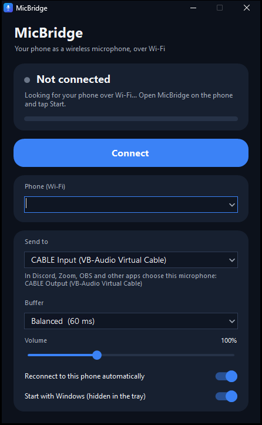

# MicBridge

Use an Android phone as a **wireless microphone** for a Windows PC. The phone sends its microphone over your
Wi-Fi network; nothing is plugged in. The PC only has to be on the same router (by Wi-Fi or by network cable).

- **Small:** a 100 KB Windows app that uses about 12 MB of memory, and a 70 KB Android app.
- **Low delay:** uncompressed audio with a small, adjustable buffer.
- **Hands-off:** finds the phone by itself and reconnects on its own after the first time.
- **Stream friendly:** its playback is kept out of Discord/OBS application-audio capture, so your voice is
  not heard twice when you share your screen.

## Download

| | File | Needs |
|---|---|---|
| Windows app | [`dist/MicBridge.exe`](dist/MicBridge.exe) | Windows 10 or 11, no installer |
| Android app | [`dist/MicBridge.apk`](dist/MicBridge.apk) | Android 7.0 or newer |

## One-time setup

1. **PC: install a virtual microphone driver.** Windows only shows a microphone if a driver provides one, and
   MicBridge does not contain a driver. The free [VB-CABLE](https://vb-audio.com/Cable/) does the job. Despite
   its name it is a small program, not a real cable. Download it, run `VBCABLE_Setup_x64.exe` as
   administrator and restart the PC.
   (Afterwards, check *Settings > System > Sound* and make sure your normal speakers and microphone are still
   the defaults; VB-CABLE sometimes makes itself the default.)
2. **Phone: install the APK.** Copy `MicBridge.apk` to the phone, open it and allow "install unknown apps"
   when Android asks.

## Using it

1. Phone: open MicBridge, tap **Start** and allow the microphone.
2. PC: open `MicBridge.exe`. The phone appears under **Phone (Wi-Fi)**; click **Connect**.
   The first time, tap **Allow** on the phone. After that this PC reconnects by itself.
3. PC: under **Send to**, *CABLE Input (VB-Audio Virtual Cable)* is selected automatically.
4. In Discord, Zoom, OBS, etc. choose the microphone **CABLE Output (VB-Audio Virtual Cable)**.

If the phone is not found automatically, type the address shown in the phone app into the **Phone** box.

## Options

- **Buffer** (PC): lower = less delay, higher = more tolerant of weak Wi-Fi. Start with *Balanced*.
- **Volume** (PC): up to 300 % if the phone is too quiet.
- **Microphone mode** (phone): *Standard*, *Voice chat* (the phone's echo and noise reduction) or *Raw*.
- **Mute** (phone): sends silence without dropping the connection.
- Minimising the PC window hides it in the tray. *Start with Windows* launches it there at sign-in.

## If something does not work

- **Phone never shows up:** both devices must be on the same network. Guest Wi-Fi and "AP isolation"
  block devices from seeing each other. Typing the phone's address always works if they can reach each other.
- **Audio stops when the phone screen turns off:** turn on *Keep screen on* in the phone app, or exclude
  MicBridge from battery optimisation in Android's settings.
- **Crackling:** pick a higher **Buffer**, and keep the phone close to the Wi-Fi router (5 GHz Wi-Fi is best).
- **Other apps hear nothing:** check that **Send to** is *CABLE Input* and the other app's microphone is
  *CABLE Output*.

## How it works

The phone listens on UDP port 28777. The PC searches by broadcast, connects, and the phone then sends
48 kHz 16-bit mono audio in 10 ms packets. The PC keeps a small jitter buffer and nudges playback speed
by a fraction of a percent so the two clocks never drift apart, then plays the result into the virtual
cable, whose other end Windows presents as a microphone. That playback is marked so that application-audio
capture (Discord and OBS stream sound) leaves it out.

The PC always talks first, so no Windows Firewall rule is needed. A PC has to be allowed once on the phone
before it can connect. Audio is uncompressed and unencrypted, so use it on networks you trust.

## Building from source

Everything is plain source; there are no third-party libraries in either app.

- **PC** (`pc/`, C#, WinForms): `powershell -ExecutionPolicy Bypass -File pc\build.ps1`
  It uses the C# compiler that is built into Windows, so nothing needs installing.
- **Android** (`android/`, Java): `powershell -ExecutionPolicy Bypass -File android\build.ps1`
  It needs JDK 17 and the Android SDK build-tools 35 and platform 35 (found through `JAVA_HOME` and
  `ANDROID_HOME`; see the top of the script). No Gradle or Android Studio is involved.
  The first build creates a signing key in `android/signing`, which is deliberately not part of this
  repository. Keep that folder: builds signed with the same key install as updates, a different key means
  uninstalling first.
- **Icons** (`assets/make-icons.ps1`): redraws the icon in every size both apps need.

Both scripts write to `dist/`.

| Folder | What is in it |
|---|---|
| `pc/src` | The Windows app: `Engine.cs` (network), `JitterBuffer.cs`, `WasapiOut.cs` (audio out), `MainForm.cs` and `Theme.cs` (window) |
| `android/src` | The phone app: `StreamCore.java` (network and streaming), `MicSource.java`, `MicService.java`, `MainActivity.java` |
| `android/res` | The phone app's layout, colours, texts and icons |
| `assets` | Icon generator and screenshot |
| `dist` | The ready-to-use apps |
